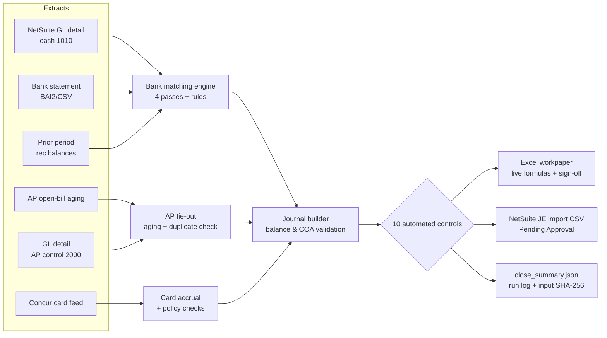

# Month-End Close Automation: Cash Reconciliation, AP Tie-Out & Card Accrual

A working Python pipeline that automates three month-end close tasks that usually take a lot of manual work. It produces an audit-ready Excel workpaper and journal entries ready for NetSuite import:

1. **Bank-to-GL cash reconciliation.** A multi-pass matching engine, rule-based exception classification, and the standard two-sided bank reconciliation.
2. **AP subledger-to-GL control account tie-out.** It also produces an aging and runs a duplicate vendor bill control.
3. **Corporate card (Concur) accrual.** It accrues spend that isn't yet on an approved expense report, auto-reverses it the next period, and flags policy exceptions.

All data is synthetic, for a fictional company ("Summit Outdoor Co."), and generated with a fixed seed, so every run is reproducible.

> Built by Meghna Batra, ERP Finance Systems consultant (Infor LN, NetSuite, SAP Concur, BlackLine).
> This is a portfolio sample. It contains no client data.

---

## Results on the sample October 2026 close

| Area | Result |
|---|---|
| Cash rec (GL 1010) | **Reconciled to $0.00**. 95% of bank lines auto-matched (96 of 101) across 4 match rules |
| Exceptions found automatically | 2 deposits in transit, 1 outstanding check, 3 bank fees, 1 interest credit, 1 NSF return, 1 **transposition error** ($15,320 keyed vs $13,520 actual), 1 **duplicate GL posting** |
| AP tie-out (GL 2000) | $12,500 difference fully explained: a manual accrual JE posted to the AP control account instead of Accrued Liabilities. Reclass JE proposed |
| Duplicate bill control | 1 re-keyed vendor invoice caught ($14,771.58 exposure). Payment hold recommended |
| Card accrual | $6,452.63 accrued across 5 GL accounts, auto-reversing 11/1. 22 policy flags (missing receipts, aged items, split purchases) |
| Journal entries | 7 balanced entries staged as *Pending Approval* in a NetSuite CSV import layout |
| Controls | 10 automated controls: 7 PASS, 3 REVIEW (human review by design), 0 FAIL |

---

## How it works



### Bank matching passes

| Pass | Rule | What it handles |
|---|---|---|
| 1 | Reference + amount | Check numbers and remittance references |
| 1b | Reference, amount differs | Flags keying errors. A difference divisible by 9 is labeled a likely **transposition** |
| 2 | Amount + date window (±3 days, closest wins) | ACH credits with no reference |
| 3 | Many-to-one subset match | Lockbox and batch deposits that combine several GL receipts |
| Rules | Regex on the bank description | Fees, interest, and NSF returns, each mapped to its JE account |
| Classify | Cutoff windows and duplicate detection | Outstanding checks, deposits in transit, duplicate postings. Anything else is **Unexplained** and fails the control |

Tolerances, windows, keyword rules, account mappings and policy limits all live in `config.py`. A controller can change them without touching the matching logic.

### Automated controls (SOX-style)

| # | Control | Fails or flags when |
|---|---|---|
| C1 | Input completeness and schema | An extract or a required column is missing |
| C2 | Prior period rolled forward | Opening balance isn't from a reconciled prior period |
| C3 | Cash rec difference = 0 | Adjusted bank ≠ adjusted book |
| C4 | No unexplained items | Any item can't be classified |
| C5 | AP subledger ties to GL | Difference isn't explained by identified manual JEs |
| C6 | Duplicate vendor bills | Same vendor + invoice #, or same amount within 7 days |
| C7 | Card categories mapped | An expense category has no GL account (the run stops) |
| C8 | Card policy compliance | Missing receipt over $75, unsubmitted more than 30 days, possible split purchase |
| C9 | JEs balanced and accounts valid | Any entry is out of balance or uses an unknown account (the run stops) |
| C10 | Segregation of duties | Always REVIEW. Entries are staged and a human approves them before posting |

### The workpaper (`Close_Workpaper_2026-10.xlsx`)

* The **Close Summary** tab is built with live `SUMIFS` formulas that point at the detail tabs, so a reviewer can trace every number to its supporting lines. Blue figures come from source extracts. Black figures are formulas.
* Detail tabs: Bank Matches, GL Unmatched, Bank Unmatched, Amount Variances, AP Aging, AP Recon Items, AP Duplicate Bills, Card Accrual Detail and by Account, Card Policy Flags, Proposed JEs, Control Log.
* There's a sign-off block for preparer, reviewer and approval.

---

## Run it

```bash
pip install -r requirements.txt
python run_close.py --generate          # build sample extracts, then run the close
python run_close.py                     # re-run on the existing sample extracts
python -m pytest -q                     # 13 tests: matching rules, accruals, JE balancing, end to end
```

Outputs are written to the project folder: the workpaper, `NetSuite_JE_Import_2026-10.csv`, `open_items_gl.csv` (rolls forward to the next month), and `close_summary.json` (run ID, metrics, control results, and a SHA-256 hash of every input for the audit trail).

### Files

| Type | Files |
|---|---|
| Code | `config.py` (period, chart of accounts, tolerances, rules, policy limits) · `data_gen.py` (seeded synthetic extracts) · `bank_recon.py` (matching engine and reconciliation) · `ap_tieout.py` (subledger tie-out, aging, duplicate bills) · `card_accrual.py` (Concur accrual and policy flags) · `journal.py` (balanced JE builder) · `workpaper.py` (Excel workpaper) · `pipeline.py` (orchestration, controls, audit trail) · `run_close.py` (command-line entry point) |
| Tests | `test_close.py` |
| Sample inputs | `gl_cash_detail.csv` · `bank_statement.csv` · `ap_open_bills.csv` · `gl_ap_control_detail.csv` · `concur_card_transactions.csv` · `prior_period_balances.csv` |
| Outputs | `Close_Workpaper_2026-10.xlsx` · `NetSuite_JE_Import_2026-10.csv` · `open_items_gl.csv` · `close_summary.json` |

---

## Taking this to production

| Sample | In a real environment |
|---|---|
| CSV extracts | NetSuite saved search or SuiteQL via REST, bank BAI2 or camt.053 over SFTP, Concur Expense API |
| CSV JE file | NetSuite CSV Import or a RESTlet. Infor LN via ION BOD. Approval routing in NetSuite |
| Scheduled CLI | Workday-calendar trigger (BD+1, BD+2) through cron, Airflow, or the Celigo/Boomi scheduler |
| Excel workpaper | BlackLine or FloQast attachment, or a SharePoint folder per period |
| Single entity and currency | Loop over subsidiaries, add FX revaluation and intercompany elimination matching |
